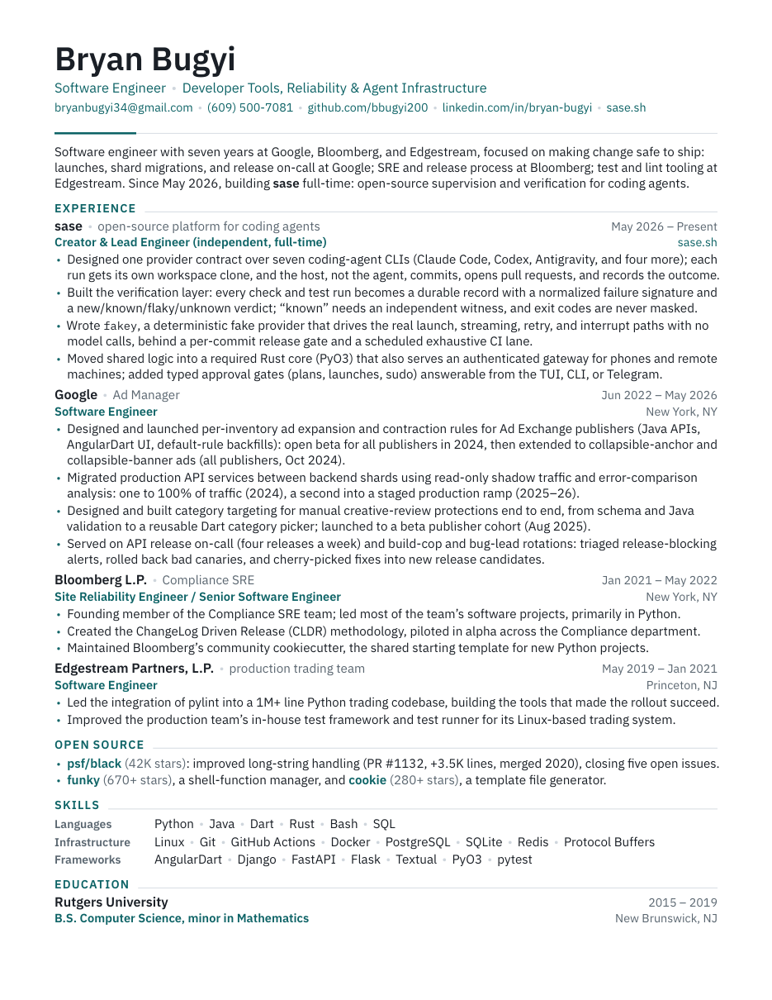

# Bryan Bugyi — CV

## Download

- [BryanBugyi_CV.pdf](BryanBugyi_CV.pdf) — one page; send this by default.
- [BryanBugyi_CV_extended.pdf](BryanBugyi_CV_extended.pdf) — two pages, for hiring
  managers and Staff-level packets.

## Build

Requires pdfLaTeX with TeX Live packages `plex`, `microtype`, `enumitem`,
`needspace`, `hyperref`, `xcolor`, `geometry`, plus `mutool` from MuPDF for the
preview and checks.

- `make` — builds both PDFs, the page-1 preview image, and runs the checks.
- `make check` — verifies page counts (1 and 2), zero bad boxes, expected employer
  keywords in each edition, and that no forbidden strings appear in the source.
- `make clean` — removes LaTeX intermediates.

## Editing rules

One source (`BryanBugyi_CV.tex`) builds both editions: `\more{...}` is
extended-only and `\short{...}` is one-page-only. Facts never differ between
editions, only selection. Tailor per application by changing only the summary's
last clause, the bullet order, and which `\more` bullets are promoted. Never
reword a claim or change dates or titles.
